<a href="https://zeeshan-shakeel.com">
  
</a>

  
  
  
  

 



> Three countries raised me; the feed finished the job. I work across the full marketing stack (social commerce, lifecycle email, measurement, paid) and I build the AI tools that make it faster.

 



<b>› open the receipts</b> — where those numbers came from

 

| Year | Where | Role | What moved |
|---|---|---|---|
| 2026 | **Swano Laundry** | Brand + Front-End Lead | Turned a 1965 dry cleaner into on-demand delivery: 49-page brand book, 29 touchpoints, 35 print-ready artworks, one React codebase for web + iOS + Android |
| 2026 | **Sonage Skincare** | Digital Marketing Intern | +145% TikTok profile views, an AI content pipeline (Seedream, Higgsfield, Photoshop, Lightroom), 8 campaigns across Shopify, TikTok Shop and Amazon |
| 2025 | **Delta Sigma Pi** | Marketing Team | 15K+ organic Instagram video views across CSUN |
| 2024 | **Threadscapes** | Social Media Manager | +25% content views, 5+ influencer partnerships |
| — | **Careem** · **Eureka 2.0** | Ad crew · Pitch | Shot an ad with a 5-person crew · 1st place business pitch |

 


<b>4 live demos</b> · click any preview to try it yourself · no login needed

<table>
  <tr>
    <td width="50%" valign="top">
      <a href="https://zeeshan-shakeel.com/projects/campaign-builder"></a> 
      <b>AI Campaign Builder</b>&nbsp;&nbsp;<code>strategy</code> 
      A brief in, an 11-section campaign out. Ad copy with live Google character limits, export to PDF.  
      
    </td>
    <td width="50%" valign="top">
      <a href="https://zeeshan-shakeel.com/projects/seo-engine"></a> 
      <b>SEO Content Engine</b>&nbsp;&nbsp;<code>search</code> 
      Keyword clusters sorted by intent, an editorial queue, title tags, meta descriptions and a 30-day plan.  
      
    </td>
  </tr>
  <tr>
    <td width="50%" valign="top">
      <a href="https://zeeshan-shakeel.com/projects/performance-dashboard"></a> 
      <b>Marketing Dashboard</b>&nbsp;&nbsp;<code>analytics</code> 
      180 days of campaign data turned into budget calls. ROAS, CPC, CTR and CPL worked out from real totals, with three budget scenarios.  
      
    </td>
    <td width="50%" valign="top">
      <a href="https://zeeshan-shakeel.com/projects/content-calendar"></a> 
      <b>Content Calendar</b>&nbsp;&nbsp;<code>content</code> 
      A 30-day plan across Instagram, TikTok and LinkedIn built on six content pillars. Exports to CSV and PDF.  
      
    </td>
  </tr>
  <tr>
    <td colspan="2" valign="top">
      <b>side quest →</b> <a href="https://github.com/zeeshanshakeel/detent"><b>detent</b></a>&nbsp;&nbsp;<code>Swift</code>&nbsp;&nbsp;a Mac menu bar app that adds trackpad haptics and click sounds to scrolling
    </td>
  </tr>
</table>

#### toolkit

  <b>MARKETING</b> 
  
  
  
  
  
  
  
  

  <b>AI CONTENT</b> 
  
  
  
  
  

  <b>BUILD</b> 
  

<b>› the route</b> — Karachi → Kuala Lumpur → Los Angeles

 

- **California State University, Northridge**: B.S. Business Administration, Marketing (minor in Management), class of 2027
- **Taylor's University, Kuala Lumpur**: American Degree Transfer Program, 2023
- **Beaconhouse, Karachi**: Cambridge O Levels, 2020
- **10 certifications**: Google Ads, Google Analytics, Meta, IBM, Stukent, LinkedIn Learning and more

#### activity

<picture>
  <source media="(prefers-color-scheme: dark)" srcset="https://raw.githubusercontent.com/zeeshanshakeel/zeeshanshakeel/output/snake-dark.svg" />
  <source media="(prefers-color-scheme: light)" srcset="https://raw.githubusercontent.com/zeeshanshakeel/zeeshanshakeel/output/snake-light.svg" />
  
</picture>

<!-- Add these back once there's more activity:

  
  

-->

 


  Open to <b>full-time marketing roles</b>, especially where marketing meets AI. 
  If you've read this far, the funnel worked. Say hi.

  
  
  


  

